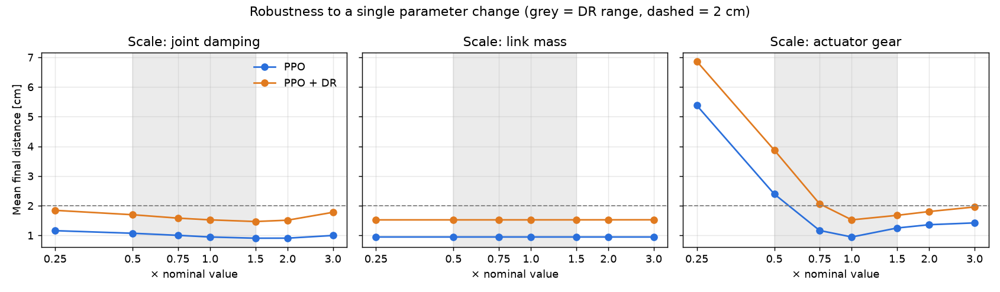
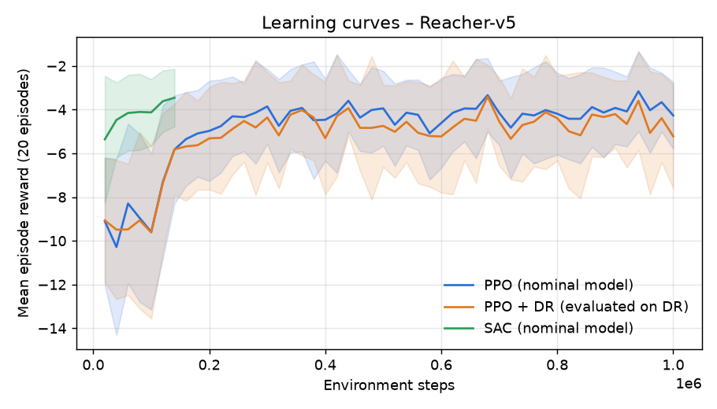

# reacher-sim2real-rl

I train a reinforcement-learning policy (PPO) that moves the fingertip of the two-link MuJoCo arm `Reacher-v5` to a random target. Then I run a small-scale sim-to-real experiment: how much accuracy the policy loses when the "real robot" has different physics than the simulator, and whether domain randomization helps.


## Results

100 episodes per cell, the same seeds for every policy, deterministic actions. "Final distance" is the fingertip–target distance at the last step of the episode (50 steps = 1 s). Success = final distance < 2 cm.

| Policy | Model | Mean reward | Mean final distance ± SE [cm] | Median [cm] | Success (< 2 cm) |
|---|---|---:|---:|---:|---:|
| Random | Nominal model | -42.33 ± 3.81 | 18.28 ± 0.84 | 16.53 | 0% |
| Random | "Real robot" | -42.65 ± 4.25 | 17.00 ± 0.83 | 16.49 | 2% |
| Random | "Real robot", weak motors | -43.32 ± 4.53 | 18.60 ± 0.82 | 17.58 | 0% |
| **PPO** | Nominal model | -3.93 ± 1.81 | **1.01 ± 0.06** | 0.85 | **92%** |
| PPO | "Real robot" | -4.52 ± 2.10 | 0.86 ± 0.06 | 0.73 | 94% |
| PPO | "Real robot", weak motors | -5.76 ± 2.70 | 1.62 ± 0.12 | 1.43 | 74% |
| PPO + DR | Nominal model | -4.39 ± 2.10 | 1.59 ± 0.10 | 1.48 | 76% |
| PPO + DR | "Real robot" | -5.02 ± 2.50 | 1.63 ± 0.19 | 1.15 | 76% |
| PPO + DR | "Real robot", weak motors | -6.31 ± 3.17 | 3.10 ± 0.38 | 2.12 | 46% |
| **SAC** | Nominal model | -3.58 ± 1.49 | **0.84 ± 0.06** | 0.71 | **97%** |
| SAC | "Real robot" | -4.12 ± 1.67 | 0.83 ± 0.05 | 0.73 | 97% |
| SAC | "Real robot", weak motors | -5.20 ± 2.18 | 0.93 ± 0.06 | 0.78 | 96% |

Raw numbers: [`results/results.json`](results/results.json), robustness sweep: [`results/sweep.json`](results/sweep.json).

**Key findings**

1. **PPO vs random policy:** mean final error drops from 18.3 cm to 1.0 cm, and 92% of episodes end within 2 cm of the target.
2. **The sim-to-real gap was smaller than I expected.** On the "real robot" (joint damping ×2, link mass ×1.5, actuator gear ×0.8, sensor noise σ = 0.01) PPO loses no accuracy: 0.86 cm vs 1.01 cm. The policy runs closed-loop, so it corrects its motion from observations. Only the reward drops, because a weaker actuator needs larger actions, and those are penalized.
3. **Domain randomization (±50%) made things worse in this task.** PPO + DR is less accurate than plain PPO on every model: 1.59 vs 1.01 cm on the nominal one, 1.63 vs 0.86 cm on the "real robot", and 3.10 vs 1.62 cm with weak motors.
4. **Why DR did not help:** I randomized parameters that barely affect this model (see below), while the one parameter that does break the policy (gear < 0.5) was outside the randomization range. The policy had to fit many dynamics at once and lost precision without gaining robustness where it mattered. Takeaway: DR works when you randomize what actually differs between sim and the robot.
5. **SAC was the most accurate and the most robust:** 0.84 cm / 97% on the nominal model and still 0.93 cm / 96% with weak motors, where PPO drops to 74% (see [PPO vs SAC](#ppo-vs-sac)).
6. **Results vary between training runs.** An earlier run of the same code with the same seed, on a different machine and library versions, gave PPO 1.46 cm / 80% and SAC 1.93 cm / 63%. Differences of ~0.5 cm between two variants are therefore not conclusive with a single seed.

### Robustness to a single parameter



- **Link mass has no effect.** In the Reacher XML the joints have `armature = 1`, while the link inertia is about 4·10⁻⁵ kg·m². The effective joint inertia is almost entirely the armature (in a real robot: rotor inertia reflected through the gearbox), so changing `body_mass` does nothing. To really vary inertia you would randomize `dof_armature`.
- **Damping has a small effect.** With inertia 1 and damping 1 the time constant is about 1 s, the length of a whole episode. Motion is limited mostly by torque, not by damping.
- **Actuator gear (motor torque) matters most.** PPO's error grows to 2.4 cm at ×0.5 and 5.4 cm at ×0.25 (PPO + DR: 3.9 and 6.9 cm). I checked whether the policy actually breaks: with gear ×0.25 and the episode extended from 50 to 100 steps, PPO's success rate rises from 5% to 58% (mean 2.7 cm). The policy still heads to the target, it just does not get there within 1 s.

### Learning curves



Evaluation every 20k steps, 20 episodes. PPO + DR is evaluated on the DR distribution, i.e. the one it trains on. The best model is always selected on the training distribution, never on the "real robot", so the test set is not leaked into model selection.

### PPO vs SAC

SAC passes a mean evaluation reward of −5 after ~40k steps, PPO after ~200k, so SAC is ~5× more sample-efficient. On a laptop CPU, however, SAC is much slower in wall-clock time: 150k steps took ~50 min (~50 steps/s), while 1M PPO steps took ~8 min (~2000 steps/s). SAC performs a gradient update after every environment step and uses a single environment; PPO collects data from 8 parallel environments and updates in batches.

After 150k steps SAC is the most accurate policy (0.84 cm, 97%) and barely degrades on the perturbed models (0.93 cm with weak motors). A possible explanation is that off-policy learning with entropy regularization covers a wider range of states, including slow approaches, but I have not tested this. In the earlier run SAC was less accurate than PPO (1.93 vs 1.46 cm), so this ranking also needs more seeds. If real-robot samples are expensive, an off-policy method like SAC is the natural choice.

## What's inside

| File | Purpose |
|---|---|
| `reacher_s2r/envs.py` | environment factory: `nominal`, `real`, `real_hard`, `dr`; wrappers `FixedPhysics`, `DomainRandomization`, `ObsNoise` |
| `reacher_s2r/policy.py` | loads a model together with its `VecNormalize` statistics |
| `train.py` | PPO / SAC training with `EvalCallback` and TensorBoard logs |
| `evaluate.py` | results table (random / PPO / PPO + DR / SAC × models) |
| `sweep.py` | changes one physics parameter at a time → robustness plot |
| `make_gif.py`, `plot_curves.py` | GIF and learning curves |
| `check_env.py` | environment smoke test with random actions in a window |
| `models/` | trained models (`best_model.zip` + `vecnormalize.pkl`) |

**"Real robot"** is the nominal model with parameters changed through `env.unwrapped.model`: arm `dof_damping` ×2, link `body_mass` ×1.5, `actuator_gear` ×0.8, plus Gaussian noise σ = 0.01 on observations. The "weak motors" variant uses gear ×0.5. Reward and distance are computed from the true state, not the noisy one.

**Domain randomization:** on every `reset()` damping, mass and gear are sampled independently from U[0.5, 1.5], plus the same observation noise as on the "real robot".

**PPO hyperparameters** come from [RL Baselines3 Zoo](https://github.com/DLR-RM/rl-baselines3-zoo) for Reacher (γ = 0.9, `n_steps` = 512, 8 envs, observation and reward normalization with `VecNormalize`). My first run with default PPO settings and no normalization converged to only ~6 cm (10% success). Observation normalization was the key fix: the fingertip→target vector is on the order of centimeters, while the rest of the observation is sin/cos of joint angles. SAC uses SB3 defaults without normalization.

## How to run

Python 3.12. Newer versions (3.13, 3.14) may not have wheels for all dependencies yet; if your system Python is newer, `uv venv --python 3.12 .venv` installs 3.12 alongside it. No GPU needed: a small MLP trains faster on CPU.

```bash
python3.12 -m venv .venv && source .venv/bin/activate   # Windows: .venv\Scripts\activate
pip install -r requirements.txt

python check_env.py                       # window with the arm and random actions

python train.py --env nominal             # policy A, 1M steps (~8 min on a laptop CPU)
python train.py --env dr                  # policy B with domain randomization
python train.py --env nominal --algo sac --timesteps 150000   # optional, ~50 min

python evaluate.py                        # results/results.md + results.json
python sweep.py                           # docs/robustness_sweep.png
python plot_curves.py                     # docs/learning_curves.png
python make_gif.py                        # docs/reacher.gif
tensorboard --logdir runs/
```

Trained models are included, so `evaluate.py`, `sweep.py` and `make_gif.py` work without training. On headless Linux the GIF renders through `MUJOCO_GL=egl`; on Windows set `MUJOCO_GL=glfw`.

Results in this README come from training on a laptop CPU (Dell Vostro 3520, Ubuntu, Python 3.12) with Gymnasium 1.4.0, MuJoCo 3.x and Stable-Baselines3 2.9.2. Every policy was trained with a single seed (`seed=0`).

## Limitations

- **Reacher is a contact-free, force-free task.** The arm moves in free space, and the sim-to-real gap here covers only kinematics and actuator dynamics. The hardest part of real sim-to-real is contact, friction and forces. The natural next step is a **peg-in-hole task with a force/torque sensor**, where the policy must react to contact.
- **One seed per training run.** Two runs of the same code already differed by ~0.5 cm (see key finding 6), so the PPO vs SAC ranking in particular may change with another seed. Stronger conclusions need 3–5 seeds per variant.
- **The "real robot" is also a simulation**, with perturbations I chose by hand. Real sources of the gap, such as control-loop latency, backlash, actuator saturation and nonlinearities, are not modeled.
- **DR randomized low-impact parameters** (mass, while armature dominates). A better range: `dof_armature`, a wider gear range, action delay.

## Next steps

- DR over `dof_armature`, action delay and gear in the 0.25–1.5 range.
- 3–5 seeds per variant and confidence intervals in the table.
- A contact task (peg-in-hole) with force observations.
