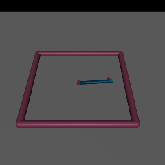

# reacher-sim2real-rl

I train a reinforcement-learning policy (PPO) that moves the fingertip of the two-link MuJoCo arm `Reacher-v5` to a random target. Then I run a small-scale sim-to-real experiment: how much accuracy the policy loses when the "real robot" has different physics than the simulator, and whether domain randomization helps.



## Results

100 episodes per cell, the same seeds for every policy, deterministic actions. "Final distance" is the fingertip–target distance at the last step of the episode (50 steps = 1 s). Success = final distance < 2 cm.

| Policy | Model | Mean reward | Mean final distance ± SE [cm] | Median [cm] | Success (< 2 cm) |
|---|---|---:|---:|---:|---:|
| Random | Nominal model | -42.33 ± 3.81 | 18.28 ± 0.84 | 16.53 | 0% |
| Random | "Real robot" | -42.65 ± 4.25 | 17.00 ± 0.83 | 16.49 | 2% |
| Random | "Real robot", weak motors | -43.32 ± 4.53 | 18.60 ± 0.82 | 17.58 | 0% |
| **PPO** | Nominal model | -4.18 ± 2.21 | **1.46 ± 0.15** | 1.06 | **80%** |
| PPO | "Real robot" | -4.74 ± 2.47 | 1.34 ± 0.12 | 0.94 | 83% |
| PPO | "Real robot", weak motors | -5.94 ± 3.13 | 2.06 ± 0.33 | 1.21 | 75% |
| PPO + DR | Nominal model | -4.32 ± 2.09 | 1.62 ± 0.11 | 1.43 | 67% |
| PPO + DR | "Real robot" | -5.07 ± 2.59 | 1.75 ± 0.24 | 1.09 | 71% |
| PPO + DR | "Real robot", weak motors | -6.33 ± 3.22 | 3.00 ± 0.37 | 2.00 | 50% |
| SAC | Nominal model | -3.90 ± 1.66 | 1.93 ± 0.12 | 1.59 | 63% |
| SAC | "Real robot" | -4.37 ± 1.82 | 1.85 ± 0.12 | 1.56 | 65% |
| SAC | "Real robot", weak motors | -5.31 ± 2.27 | 1.87 ± 0.12 | 1.62 | 67% |

Raw numbers: [`results/results.json`](results/results.json), robustness sweep: [`results/sweep.json`](results/sweep.json).

**Key findings**

1. **PPO vs random policy:** mean final error drops from 18.3 cm to 1.5 cm, and 80% of episodes end within 2 cm of the target.
2. **The sim-to-real gap was smaller than I expected.** On the "real robot" (joint damping ×2, link mass ×1.5, actuator gear ×0.8, sensor noise σ = 0.01) PPO loses no accuracy: 1.34 cm vs 1.46 cm, within the error bars. The policy runs closed-loop, so it corrects its motion from observations. Only the reward drops, because a weaker actuator needs larger actions, and those are penalized.
3. **Domain randomization (±50%) did not help in this task.** PPO + DR is slightly less accurate on the nominal model (1.62 cm) and no better on the perturbed ones. With weak motors it is worse (3.0 cm vs 2.1 cm).
4. **Why DR did not help:** I randomized parameters that barely affect this model (see below), while the one parameter that does break the policy (gear < 0.5) was outside the randomization range. Takeaway: DR works when you randomize what actually differs between sim and the robot. Randomizing "a bit of everything" costs accuracy and buys nothing.

### Robustness to a single parameter


- **Link mass has no effect.** In the Reacher XML the joints have `armature = 1`, while the link inertia is about 4·10⁻⁵ kg·m². The effective joint inertia is almost entirely the armature, so changing `body_mass` does nothing. To really vary inertia you would randomize `dof_armature`.
- **Damping has a small effect.** With inertia 1 and damping 1 the time constant is about 1 s, the length of a whole episode. Motion is limited mostly by torque, not by damping.
- **Actuator gear (motor torque) matters most.** At ×0.5 the error grows to ~2.2 cm, at ×0.25 to ~5 cm. I checked whether the policy actually breaks: with gear ×0.25 and the episode extended from 50 to 100 steps, PPO reaches 1.8 cm (62% success). The policy still reaches the target, it just does not fit in 1 s.

### Learning curves


Evaluation every 20k steps (SAC every 10k), 20 episodes. PPO + DR is evaluated on the DR distribution, i.e. the one it trains on. The best model is always selected on the training distribution, never on the "real robot", so the test set is not leaked into model selection.

### PPO vs SAC

SAC passes a mean reward of −5 after ~30k steps, PPO after ~180k, so SAC is ~6× more sample-efficient. On CPU, however, SAC is much slower in wall-clock time (~85 vs ~1000–2000 steps/s), because it updates the network after every step. After 150k steps SAC has the best mean reward (it approaches the target quickly) but ends further away than PPO (1.9 vs 1.5 cm). It turned out to be the most robust to weak motors.

## What's inside

| File | Purpose |
|---|---|
| `reacher_s2r/envs.py` | environment factory: `nominal`, `real`, `real_hard`, `dr`; wrappers `FixedPhysics`, `DomainRandomization`, `ObsNoise` |
| `reacher_s2r/policy.py` | loads a model together with its `VecNormalize` statistics |
| `train.py` | PPO / SAC training with `EvalCallback` and TensorBoard logs |
| `evaluate.py` | results table (random / PPO / PPO + DR / SAC × models) |
| `sweep.py` | changes one physics parameter at a time → robustness plot |
| `make_gif.py`, `plot_curves.py` | GIF and learning curves |
| `check_env.py` | environment smoke test with random actions in a window |
| `models/` | trained models (`best_model.zip` + `vecnormalize.pkl`) |

**"Real robot"** is the nominal model with parameters changed through `env.unwrapped.model`: arm `dof_damping` ×2, link `body_mass` ×1.5, `actuator_gear` ×0.8, plus Gaussian noise σ = 0.01 on observations. The "weak motors" variant uses gear ×0.5. Reward and distance are computed from the true state, not the noisy one.

**Domain randomization:** on every `reset()` damping, mass and gear are sampled independently from U[0.5, 1.5], plus the same observation noise as on the "real robot".

**PPO hyperparameters** come from [RL Baselines3 Zoo](https://github.com/DLR-RM/rl-baselines3-zoo) for Reacher (γ = 0.9, `n_steps` = 512, 8 envs, observation and reward normalization with `VecNormalize`). My first run with default PPO settings and no normalization converged to only ~6 cm (10% success). Observation normalization was the key fix: the fingertip→target vector is on the order of centimeters, while the rest of the observation is sin/cos of joint angles. SAC uses SB3 defaults without normalization.

## How to run

Python 3.12 (3.13 may cause dependency issues). No GPU needed: a small MLP trains faster on CPU.

```bash
python3.12 -m venv .venv && source .venv/bin/activate   # Windows: .venv\Scripts\activate
pip install -r requirements.txt

python check_env.py                       # window with the arm and random actions

python train.py --env nominal             # policy A, 1M steps (~10 min on 2 cores)
python train.py --env dr                  # policy B with domain randomization
python train.py --env nominal --algo sac --timesteps 150000   # optional

python evaluate.py                        # results/results.md + results.json
python sweep.py                           # docs/robustness_sweep.png
python plot_curves.py                     # docs/learning_curves.png
python make_gif.py                        # docs/reacher.gif
tensorboard --logdir runs/
```

Trained models are included, so `evaluate.py`, `sweep.py` and `make_gif.py` work without training. On headless Linux the GIF renders through `MUJOCO_GL=egl`; on Windows set `MUJOCO_GL=glfw`.

Tested with Gymnasium 1.4.0, MuJoCo 3.x, Stable-Baselines3 2.9.2, CPU only. Every policy was trained with a single seed (`seed=0`).

## Limitations

- **Reacher is a contact-free, force-free task.** The arm moves in free space, and the sim-to-real gap here covers only kinematics and actuator dynamics. The hardest part of real sim-to-real is contact, friction and forces. The natural next step is a **peg-in-hole task with a force/torque sensor**, where the policy must react to contact.
- **One seed per training run.** Differences of 0.1–0.3 cm between PPO and PPO + DR may change with another seed. Stronger conclusions need 3–5 seeds per variant.
- **The "real robot" is also a simulation**, with perturbations I chose by hand. Real sources of the gap, such as control-loop latency, backlash, actuator saturation and nonlinearities, are not modeled.
- **DR randomized low-impact parameters** (mass, while armature dominates). A better range: `dof_armature`, a wider gear range, action delay.

## Next steps

- DR over `dof_armature`, action delay and gear in the 0.25–1.5 range.
- 3–5 seeds per variant and confidence intervals in the table.
- A contact task (peg-in-hole) with force observations.
